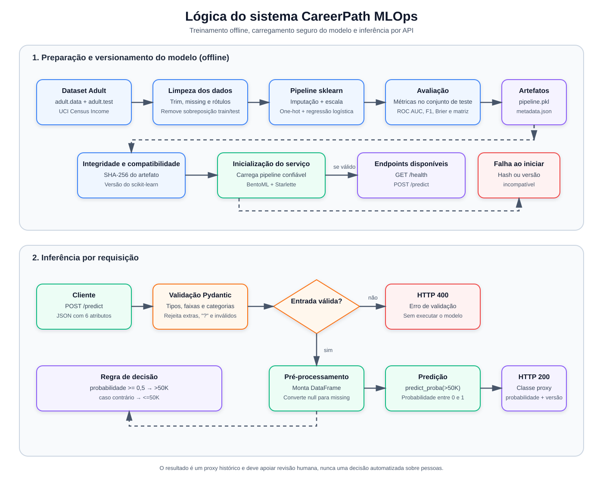

# CareerPath MLOps

PoC local de inferência socioeconômica com o dataset **Census Income (Adult)**.
O serviço recebe seis atributos de um perfil e devolve a probabilidade estimada da
classe histórica `>50K`, a classe proxy e a versão do modelo.

A AV2 acrescenta eventos JSONL de inferência, métricas Prometheus e carga
sintética reproduzível ao serviço da AV1.

> Este projeto não mede renda atual, intenção de compra, necessidade profissional
> nem potencial de carreira. O rótulo é um proxy histórico do Censo dos EUA de
> 1994 e deve apoiar revisão humana, nunca decisão automatizada sobre pessoas.


## Equipe 

- Caio Lima Bezerra
- Felipe Caminha
- João Marcelo
- Lucas Sukar
- Miguel Becker
- Luiz Arruda


## Índice

- [Pré-requisitos](#pré-requisitos)
- [Objetivo e uso responsável](#objetivo-e-uso-responsável)
- [Fluxograma da lógica](#fluxograma-da-lógica)
- [Primeira execução](#primeira-execução)
- [Contrato HTTP e exemplos](#contrato-http-e-exemplos)
- [Demonstração da AV2](#demonstração-da-av2)
- [Qualidade, Docker e CI](#qualidade-docker-e-ci)
- [Modelo, dados e limitações](#modelo-dados-e-limitações)
- [Solução de problemas](#solução-de-problemas)
- [Entrega](#entrega)

## Pré-requisitos

- Git.
- Python **3.12**. O projeto aceita `>=3.12,<3.13` e fixa `3.12` em
  [`.python-version`](.python-version).
- [uv](https://docs.astral.sh/uv/) **0.12.5** para criar o ambiente a partir do
  lockfile.
- Docker Desktop é opcional para o caminho em container.
- [just](https://just.systems/) é opcional; os comandos principais abaixo não
  dependem dele.

O modelo e sua metadata já são versionados em `models/`. A primeira inferência
não baixa dados nem treina um modelo.

## Objetivo e uso responsável

A PoC demonstra apenas o componente socioeconômico de uma priorização comercial
hipotética do Career Accelerator. Hoje, consultores atendem por ordem de chegada,
engajamento e julgamento manual. No fluxo futuro proposto, um processamento
noturno forma uma fila no CRM até 08:00, Growth revisa sua ordem e o consultor
decide se fará o contato. A probabilidade desta API é só um sinal auxiliar: não
define preço, benefício, elegibilidade ou contato automático, e não há integração
com processo real nem uso operacional de dados pessoais.

## Fluxograma da lógica

O diagrama abaixo resume o ciclo offline de treinamento e versionamento do modelo,
o carregamento seguro do artefato e o fluxo de validação e inferência da API:



## Primeira execução

Clone o repositório e instale exatamente as dependências fixadas:

```powershell
git clone --branch av2 https://github.com/Fcc2187/AV1-Entrega-Pratica-MLOps.git
cd AV1-Entrega-Pratica-MLOps
uv sync --frozen --python 3.12
```

Inicie o serviço em um terminal:

```powershell
$env:CAREERPATH_LOG_PATH = 'logs/inference-' + [guid]::NewGuid().ToString('N') + '.jsonl'
Write-Output $env:CAREERPATH_LOG_PATH
uv run --frozen bentoml serve careerpath.service:CareerPathService --host 127.0.0.1 --port 3000 --do-not-track
```

No Linux ou macOS, use:

```bash
export CAREERPATH_LOG_PATH="logs/inference-$(date -u +%Y%m%dT%H%M%S)-$$.jsonl"
printf '%s\n' "$CAREERPATH_LOG_PATH"
uv run --frozen bentoml serve careerpath.service:CareerPathService --host 127.0.0.1 --port 3000 --do-not-track
```

Pare o processo com `Ctrl+C`. O serviço fica em `http://127.0.0.1:3000`.

Em outro terminal, confirme a prontidão:

```powershell
curl.exe http://127.0.0.1:3000/health
```

Resposta esperada:

```json
{"status":"ok","model_version":"adult-income-v1"}
```

Na primeira execução, o tempo de instalação depende do download das dependências.
Aguarde a resposta de `/health` antes de enviar previsões.

## Contrato HTTP e exemplos

### `POST /predict`

Envie um objeto JSON na raiz com estes campos:

| Campo | Tipo | Regra |
| --- | --- | --- |
| `age` | inteiro | de 17 a 100 |
| `education` | texto | obrigatório, opção da lista abaixo |
| `workclass` | texto ou `null` | obrigatório; opção da lista abaixo |
| `occupation` | texto ou `null` | obrigatório; opção da lista abaixo |
| `marital_status` | texto | obrigatório, opção da lista abaixo |
| `hours_per_week` | inteiro | de 1 a 99 |

Campos extras, tipos incorretos, `?` como categoria, JSON malformado e valores
fora do intervalo recebem HTTP 400. `workclass` e `occupation` podem ser `null`.
Categorias fora da lista abaixo
recebem HTTP 400, acompanhadas da lista de opções válidas para o campo.

### Valores possíveis das variáveis categóricas

Os campos categóricos do dataset Adult usados pelo modelo aceitam apenas estes
valores:

- `workclass`: `Private`, `Self-emp-not-inc`, `Self-emp-inc`, `Federal-gov`,
  `Local-gov`, `State-gov`, `Without-pay`, `Never-worked`
- `education`: `Bachelors`, `Some-college`, `11th`, `HS-grad`, `Prof-school`,
  `Assoc-acdm`, `Assoc-voc`, `9th`, `7th-8th`, `12th`, `Masters`, `1st-4th`,
  `10th`, `Doctorate`, `5th-6th`, `Preschool`
- `marital_status`: `Married-civ-spouse`, `Divorced`, `Never-married`,
  `Separated`, `Widowed`, `Married-spouse-absent`, `Married-AF-spouse`
- `occupation`: `Tech-support`, `Craft-repair`, `Other-service`, `Sales`,
  `Exec-managerial`, `Prof-specialty`, `Handlers-cleaners`, `Machine-op-inspct`,
  `Adm-clerical`, `Farming-fishing`, `Transport-moving`, `Priv-house-serv`,
  `Protective-serv`, `Armed-Forces`

Resposta de sucesso:

```json
{
  "income_class_proxy": "<=50K",
  "probability_above_50k": 0.13588024571339077,
  "model_version": "adult-income-v1"
}
```

`income_class_proxy` é `>50K` quando `probability_above_50k >= 0.5`; caso
contrário é `<=50K`.

### PowerShell

Os arquivos em `examples/` evitam escapes frágeis no terminal. Execute as
chamadas no segundo terminal, a partir da raiz do clone:

```powershell
curl.exe -X POST http://127.0.0.1:3000/predict --header "Content-Type: application/json" --data-binary "@examples/case-1.json"
curl.exe -X POST http://127.0.0.1:3000/predict --header "Content-Type: application/json" --data-binary "@examples/case-2.json"
curl.exe -X POST http://127.0.0.1:3000/predict --header "Content-Type: application/json" --data-binary "@examples/case-3.json"
curl.exe -i -X POST http://127.0.0.1:3000/predict --header "Content-Type: application/json" --data-binary "@examples/invalid.json"
```

Os três primeiros retornam HTTP 200. `case-2.json` usa `Private` e
`Prof-specialty`. `case-3.json` exercita os dois campos anuláveis. O último
retorna HTTP 400 porque `age` é inválida.

### Linux/macOS

```bash
curl -X POST http://127.0.0.1:3000/predict -H 'Content-Type: application/json' --data-binary @examples/case-1.json
curl -X POST http://127.0.0.1:3000/predict -H 'Content-Type: application/json' --data-binary @examples/case-2.json
curl -X POST http://127.0.0.1:3000/predict -H 'Content-Type: application/json' --data-binary @examples/case-3.json
curl -i -X POST http://127.0.0.1:3000/predict -H 'Content-Type: application/json' --data-binary @examples/invalid.json
```

## Demonstração da AV2

Com o serviço rodando, use o segundo terminal na raiz. Em cada lote, salve
uma captura de `/metrics` antes e depois da carga. Use a mesma instância para
as duas capturas. As chamadas dos exemplos podem ser feitas antes da primeira
captura, pois a comparação usa deltas.

```powershell
foreach ($scenario in @('baseline', 'shifted')) {
    curl.exe -fsS http://127.0.0.1:3000/metrics -o "logs/$scenario-before.prom"
    if ($LASTEXITCODE -ne 0) { throw 'Falha na captura inicial' }
    uv run --frozen python scripts/generate_load.py --count 100 --seed 42 --scenario $scenario --invalid-every 10
    if ($LASTEXITCODE -ne 0) { throw 'Resultado inesperado na carga' }
    curl.exe -fsS http://127.0.0.1:3000/metrics -o "logs/$scenario-after.prom"
    if ($LASTEXITCODE -ne 0) { throw 'Falha na captura final' }
}
$inferenceLog = Read-Host 'Cole o caminho de log impresso no terminal do servidor'
Get-Content -LiteralPath $inferenceLog -Tail 3
Select-String -Path logs/baseline-before.prom,logs/baseline-after.prom -Pattern '^bentoml_service_request_total\{.*endpoint="/predict"'
```

No Linux ou macOS, use:

```bash
for scenario in baseline shifted; do
    curl -fsS http://127.0.0.1:3000/metrics -o "logs/$scenario-before.prom" || break
    uv run --frozen python scripts/generate_load.py --count 100 --seed 42 --scenario "$scenario" --invalid-every 10 || break
    curl -fsS http://127.0.0.1:3000/metrics -o "logs/$scenario-after.prom" || break
done
printf 'Cole o caminho de log impresso no terminal do servidor: '
IFS= read -r inference_log
tail -n 3 "$inference_log"
grep -E '^bentoml_service_request_total\{.*endpoint="/predict"' logs/baseline-before.prom logs/baseline-after.prom
```

Cada lote gera 100 eventos, 90 respostas 200 e 10 rejeições 400 planejadas.
Com a mesma seed, `shifted` preserva as categorias e soma 12 à idade e à
jornada semanal. Confira o aumento dos contadores de `/predict` por status
e procure no JSONL um sucesso com `output` preenchido e uma rejeição com
`outcome=client_error` e `output=null`.

O log usa um objeto JSON por linha e cresce por acréscimo. O caminho é
relativo ao diretório de trabalho, com padrão `logs/inference.jsonl`. O
processo precisa de permissão de escrita no destino. Ao reiniciar com o
mesmo caminho, os eventos anteriores permanecem no disco e os contadores
de `/metrics` iniciam uma nova janela. O arquivo fica armazenado até
remoção manual, pois o projeto usa um arquivo sem rotação automática.

Para análise, use eventos com `outcome=success` e `input_capture=complete`
nas distribuições de entrada e saída. Use os buckets cumulativos para
construir o histograma e as latências individuais do JSONL para calcular
o boxplot. Os cálculos, unidades e casos de reset estão no [guia de
métricas](docs/av2/metrics.md). Veja também o [formato do
log](docs/av2/log-format.md), o [guia de carga](docs/av2/load.md) e o
[roteiro da demonstração](docs/av2/demonstracao.md).

## Qualidade, Docker e CI

### Checks locais

```powershell
uv run --frozen ruff check .
uv run --frozen pytest -q
uv run --frozen python -m compileall -q src scripts tests
```

A suíte cobre contrato, modelo, erros, gerador de carga e sanitização do log.
O E2E sobe o BentoML duas vezes e confere a previsão, o acréscimo ao mesmo
arquivo e o reset dos contadores.

### Atalhos opcionais com just

```powershell
just sync
just serve
just check
just demo
```

`just demo` sincroniza o ambiente e executa o E2E real. As receitas são atalhos
para os comandos acima; o README continua executável sem instalar `just`.

### Docker

Em um ambiente com Docker Linux, use a imagem `careerpath-mlops:av2` e
um volume nomeado em `/app/logs`. O build e a persistência do volume nesta
versão aguardam validação em máquina com Docker. [Guia Docker](docs/av2/docker.md).

### CI

O workflow [`.github/workflows/ci.yml`](.github/workflows/ci.yml) executa em push
em `main` e `av2` e em pull requests. Ele usa ações fixadas por SHA,
instalação frozen, Ruff, pytest e compilação em Linux.

## Modelo, dados e limitações

O modelo é uma regressão logística com pré-processamento completo em um único
pipeline scikit-learn. Ele foi treinado com o
[UCI Census Income / Adult, ID 20](https://archive.ics.uci.edu/dataset/20/census+income)
(DOI `10.24432/C5GP7S`, CC BY 4.0), usando seed 42.

Features usadas: `age`, `education`, `workclass`, `occupation`, `marital-status`
e `hours-per-week`. `race` e `sex` foram excluídas; `fnlwgt`, `relationship`,
`native-country`, `capital-gain`, `capital-loss` e `education-num` também foram
excluídas por não integrarem o formulário mínimo ou duplicarem informação.

No teste oficial, após remover 25 linhas exatamente sobrepostas ao treino, o
modelo obteve accuracy `0.8331797801`, ROC-AUC `0.8825975677` e Brier
`0.1142367999`. O baseline majoritário obteve accuracy `0.7637737240` e ROC-AUC
`0.5`. Métricas, hashes, versões, contagens e limitações completas ficam em
[`models/metadata.json`](models/metadata.json).

Limitações importantes:

- O Adult representa renda histórica dos EUA em 1994; não é resultado de carreira
  nem uma medida atual de renda.
- Excluir atributos sensíveis não elimina vieses ou proxies nas demais variáveis.
- A API valida as categorias nas listas do contrato. Valores desconhecidos
  recebem HTTP 400.
- O endpoint não deve acionar crédito, elegibilidade, contratação, demissão ou
  qualquer decisão automatizada sobre pessoas.
- O pickle é carregado apenas do artefato confiável versionado; hash e versão do
  scikit-learn são verificados antes da desserialização.

## Estrutura do repositório

```text
src/careerpath/     treino, schema, modelo, serviço BentoML e monitoramento
models/             pipeline versionado e metadata
examples/           três requests válidos e um inválido
tests/              testes unitários, HTTP e E2E
scripts/            download explícito do dataset e geração de carga sintética
docs/av2/           guias, evidências, plano, checkpoints e parecer da AV2
```

## Solução de problemas

| Situação | Ação |
| --- | --- |
| `uv sync --frozen` falha | Confirme Python 3.12 e não altere `pyproject.toml`/`uv.lock` separadamente. |
| Serviço não inicia | Confirme a presença de `models/adult-income-v1.pkl` e `models/metadata.json`; o startup falha de propósito se faltarem. |
| Porta 3000 ocupada | Pare o processo que usa a porta ou ajuste `--port`, as URLs dos curls e `--url` no gerador de carga. |
| Log ausente | Confira o caminho impresso, o diretório de trabalho e a permissão de escrita. |
| Captura de métricas vazia ou incompatível | Consulte a porta do serviço e confira a resposta HTTP de `/metrics`. Compare duas capturas do mesmo processo. |
| Sem rede na apresentação | Use o ambiente e a imagem já preparados; inferência não baixa dados nem treina. |

## Entrega

O código está sob [MIT](LICENSE). A licença do código não substitui os termos da
fonte de dados UCI.

O Codex apoiou análise do enunciado, implementação, testes, revisão e
documentação. Os comandos e resultados observados estão nos
[checkpoints](docs/av2/checkpoints.md). O [histórico de uso de IA da
AV1](docs/documentacao-IA.md) registra a preparação anterior. Consulte o
[entendimento de negócio](Entendimento%20de%20neg%C3%B3cio.docx.pdf) para
o contexto do proxy, o [escopo da AV2](docs/av2/escopo.md) para a rubrica e
o [plano](docs/av2/fases.md) para os critérios de cada fase.

O [guia de revisão](docs/av2/revisao-plano.md) orienta a segunda revisão
da equipe. O [parecer](docs/av2/review.md) registra o resultado e as
limitações da validação executada.
