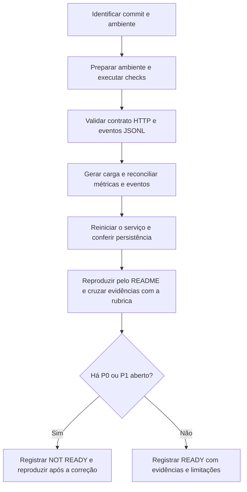

# Guia de revisão da AV2

Use este roteiro para revisar o CareerPath na branch `av2`. Registre o SHA do
commit revisado, a data, o sistema e os resultados de cada comando. A avaliação
cobre o servidor de modelos da seção 1 do enunciado, com 50 pontos de logging
e 10 de métricas. [Matriz de requisitos](escopo.md#3-requisitos-aplicáveis).

As fases 6 e 7 fecharam os achados abaixo e foram verificadas no Windows.
Use o parecer como referência ao repetir o fluxo no commit final.
[Parecer técnico](review.md).

## Estado encontrado em 11/11/2026

A leitura compara o commit `2dbf442` com o trabalho anterior ao merge. O merge
trouxe o README da AV1, o fluxograma, a documentação de uso de IA e as skills
de elaboração de prompts. Também introduziu listas fechadas nos quatro campos
categóricos do perfil. O `case-2.json` passou a usar `Private` e `Prof-specialty`.
Os testes de serviço passaram a exigir HTTP 400 com opções válidas para categorias
desconhecidas. [Contrato atualizado](../../src/careerpath/schema.py).

| Prioridade | Achado no commit observado | Verificação de fechamento |
| --- | --- | --- |
| P1 | Ruff passou, mas a suíte local teve **77 aprovados e 1 falha**. O teste de logging esperava 200 para `Operação\nTécnica`, categoria que agora recebe 400. O JSONL observado registrou `client_error` e `output=null`. | Validar o sucesso com campos anuláveis e a rejeição da categoria Unicode em cenários separados. Confirmar que o valor rejeitado permanece legível ao decodificar a linha JSONL. Rodar a suíte completa. [Testes atualizados](../../tests/test_monitoring.py#L106). |
| P1 | O plano contém marcadores de conflito no quadro de fases e no checklist da fase 4. A introdução ainda aponta para a etapa R e a fase 4, embora haja checkpoints das fases 4 e 5. | Conferir o plano consolidado, as evidências das fases 4 e 5 e os critérios de análise e revisão. [Plano](fases.md) · [Checkpoints](checkpoints.md). |
| P1 | O README descrevia `case-2.json` como exemplo de categoria desconhecida, citava CI só em `main` e mantinha comandos Docker e instruções da AV1. | Reproduzir a demonstração a partir do README atualizado em um clone do commit candidato. [README](../../README.md). |

As medições das fases 3–5 são evidências dos commits em que foram produzidas.
A mudança nos perfis de exemplo pode alterar as probabilidades da carga. Compare
as novas execuções com o contrato, os contadores esperados e a seed usada. A
validação Docker fica para outro ambiente com motor Linux. Neste PC, execute a
revisão no host. [Guia Docker](docker.md).

## Fluxo de revisão



### 1. Identificar o commit e validar o ambiente

Use um clone limpo da revisão candidata. No PowerShell, a partir da raiz:

```powershell
git branch --show-current
git rev-parse HEAD
git status --short
git diff --check
git grep -n -E '^(<<<<<<< |=======$|>>>>>>> )' -- '*.md' '*.py' '*.yml'
uv --version
uv sync --frozen --python 3.12
uv run --frozen python --version
uv run --frozen ruff check .
uv run --frozen pytest -q -o faulthandler_timeout=40
uv run --frozen python -m compileall -q src scripts tests
```

Na busca de marcadores, saída vazia e código 1 indicam ausência de ocorrências.
Anote falhas de setup e comandos que ficaram sem execução. Para CI, associe
o link e o resultado de Quality ao SHA revisado, quando a execução existir.
[Workflow Quality](../../.github/workflows/ci.yml).

### 2. Conferir HTTP e JSONL

Inicie o serviço em um terminal na raiz com um destino de log próprio da rodada.
Use a porta 3000 se estiver livre. Mantenha o caminho impresso para consultar
o mesmo arquivo no segundo terminal.

```powershell
$env:CAREERPATH_LOG_PATH = 'logs/review-' + [guid]::NewGuid().ToString('N') + '.jsonl'
Write-Output $env:CAREERPATH_LOG_PATH
uv run --frozen bentoml serve careerpath.service:CareerPathService --host 127.0.0.1 --port 3000 --do-not-track
```

| Caso | Resultado esperado |
| --- | --- |
| `GET /health` | 200, prontidão e versão `adult-income-v1`. |
| `POST /predict` com `case-1.json`, `case-2.json` e `case-3.json` | 200. O terceiro cobre `workclass` e `occupation` nulos. Conferir classe, probabilidade finita em [0, 1] e versão, comparando a resposta com `output` no JSONL. |
| `invalid.json`, categoria fora da lista e corpo JSON malformado | 400. Categoria desconhecida informa campo e opções válidas. Cada rejeição produz um evento com status correspondente, `outcome=client_error` e `output=null`. |
| Falha interna simulada pelo teste de monitoramento | 500 e evento `server_error`, com `output=null` e sem texto interno da exceção no JSONL. |
| `GET /metrics` e `GET /health` | Cada rota responde pelo HTTP e deixa a quantidade de linhas de inferência intacta. |

Em cada evento de inferência, confira uma linha JSON válida, ID distinto, timestamp
ISO 8601 UTC com microssegundos, latência em ms, status e versão. Compare as seis
features permitidas e verifique sanitização de campos extras, headers e texto de
exceções. Use os testes de truncamento e erro de escrita para verificar as
condições de falha. Confira a utilidade de `status_code`, `outcome`, `input_capture`
e `error_type` para interpretar rejeições, considerando que `output` fica nulo
nas falhas. [Dicionário do JSONL](log-format.md).

### 3. Conciliar carga, logs e métricas

Execute a sequência do guia de carga em um log novo, ou anote a quantidade de
linhas antes de cada lote para separar os eventos da rodada. Colete `/metrics`
antes e depois de cada lote na mesma instância.

| Lote com seed 42 | Eventos novos | Delta 200 | Delta 400 | Delta 5xx |
| --- | ---: | ---: | ---: | ---: |
| Baseline, 100 pedidos, inválido a cada 10 | 100 | 90 | 10 | 0 |
| Shifted, 100 pedidos, inválido a cada 10 | 100 | 90 | 10 | 0 |
| Baseline curto, 5 pedidos válidos | 5 | 5 | 0 | 0 |

O resumo da CLI, as linhas do JSONL e os deltas de `/predict` devem coincidir.
Verifique as séries `request_total` e `request_duration_seconds` do BentoML,
incluindo `_count`, `_sum` e `_bucket`. Confira o cálculo da média em ms, o
histograma pela diferença dos buckets cumulativos, o boxplot das latências
individuais e as taxas de 4xx+5xx e 5xx. Com denominador zero, espere `N/A`.
[Guia de métricas](metrics.md) e [comandos de carga](load.md).

Para as distribuições, use `outcome=success` e `input_capture=complete`. Confira
variação e tipos de idade, horas, probabilidade e latência. Compare os pares da
mesma seed. Shifted soma 12 à idade e à jornada e preserva as categorias.
Mantenha nulos nas frequências categóricas e retire ausentes das distribuições
numéricas. Confira o procedimento para reconstruir a partição de treino Adult e
calcular probabilidades de referência pelo artefato salvo. A planilha é opcional.
Se existir, compare fórmulas, unidades, quartis e casos de janela vazia ou reset
com o guia. [Procedimento e amostra histórica](load.md).

### 4. Confirmar persistência e retenção

Execute `uv run --frozen pytest -q tests/test_e2e.py`. O teste sobe dois processos
usando o mesmo arquivo temporário. Confira o prefixo anterior byte a byte, dois
eventos novos por ciclo, quatro IDs distintos e a mesma previsão para o mesmo
perfil. Os contadores de `/predict` iniciam em zero a cada ciclo. Para repetir
manualmente, pare com Ctrl+C apenas o serviço iniciado para a revisão e suba
novamente com o mesmo `CAREERPATH_LOG_PATH`. Registre a nova janela de métricas.
[Teste de reinício](../../tests/test_e2e.py#L162).

Confira a descrição de retenção do JSONL em disco e dos contadores por instância.
Em uma máquina com Docker, a verificação complementar é recriar o container com
o mesmo volume e confirmar o prefixo preservado. Registre o resultado separado
do teste no host. [Comandos Docker](docker.md).

### 5. Reproduzir a entrega e registrar o parecer

Peça a uma pessoa com clone limpo do commit candidato para seguir apenas o
README, incluindo seus links. Ela deve conseguir instalar, subir o serviço,
enviar os exemplos, provocar uma rejeição, gerar a carga e interpretar JSONL
e métricas. Registre comandos, saídas e obstáculos. Confira também a declaração
de uso de IA, as evidências sintéticas, os links e os arquivos gerados que
entram no Git. [README](../../README.md) e [plano das fases 6 e 7](fases.md).

Use **P0** quando o problema impede a execução ou demonstração. Use **P1** para
requisito aplicável sem evidência, resultado incorreto ou regressão de validação.
Use **P2** para uma melhoria que não impede o aceite. Cruze cada requisito com
uma evidência observada no commit candidato. Após corrigir P0 ou P1, repita os
cenários afetados e registre o novo SHA e o resultado da suíte.

Para registrar a segunda revisão, use a estrutura abaixo e consulte o
[parecer da fase 7](review.md).

```markdown
# Parecer de revisão da AV2

- Commit, data, revisor e ambiente
- Resultado READY ou NOT READY
- Requisitos verificados e evidência de cada um
- Achados com prioridade, arquivo/linha, comando, esperado e observado
- Correções, reexecuções e pendências
- Limitações de ambiente e link da CI do commit, quando disponível
```

`READY` exige os requisitos aplicáveis demonstrados e os achados P0 e P1
resolvidos. Use `NOT READY` enquanto houver bloqueios ou evidência obrigatória
faltando. Registre separadamente as verificações opcionais ou dependentes de
ambiente.
